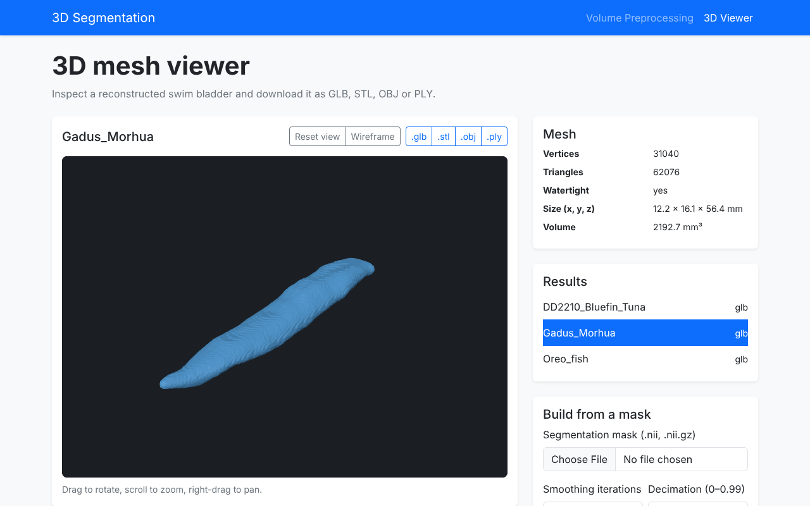

# 3D Swim Bladder Segmentation & Reconstruction

A research framework for **3D swim bladder segmentation from CT scans**, geometric mesh reconstruction, and multi-model benchmarking.

---

## Flask Application

Create and activate a virtual environment:

```bash
python3 -m venv .venv
source .venv/bin/activate
```

On Windows:

```powershell
python -m venv .venv
.venv\Scripts\activate
```

Install dependencies:

```bash
python -m pip install -r requirements.txt
```

The `src/api/config.toml` file contains application runtime settings. Adjust it
if needed, then start Flask:

```bash
python -m src.api.app
```

Open `http://127.0.0.1:5000` to verify that the standalone web application is
running.

### Application endpoints

The Flask application is organized around separate routes, so further pages
and endpoints can be added without changing the application entry point.

| Method | Endpoint | Purpose |
|---|---|---|
| `GET` | `/preprocess` | Display the volume preprocessing form |
| `GET` | `/viewer` | 3D mesh viewer (`?id=<result>` opens `results/<result>/mesh.*`) |
| `GET` | `/meshes/<id>/mesh.<fmt>` | Mesh as `glb`, `stl`, `obj` or `ply` (`?download=1` saves the file) |
| `POST` | `/process` | Load and preprocess uploaded JSON, TIFF, or DICOM data |
| `POST` | `/viewer/build` | Build a mesh from an uploaded NIfTI mask and open it in the viewer |

After `POST /process`, the **Processed volume** page displays the unified
`Volume` metadata: source format, input/output shape, spacing, units, output
value range, source SHA-256 hash, and the middle axial slice after
preprocessing.

Future route groups can be added for `/segmentation`, `/mesh`, `/metrics`, and
`/export`.

### 3D viewer

`/viewer` shows meshes stored as `results/<experiment_id>/mesh.<format>` (the
convention used by the experiment runner) in a WebGL viewer based on three.js,
loaded from a CDN. Rotate with the mouse, zoom with the wheel, switch to
wireframe, and download the mesh as `.glb`, `.stl`, `.obj` or `.ply`; formats
that were not written to disk are converted on request.

A mesh can also be built in the browser: upload a segmentation mask (`.nii` or
`.nii.gz`), choose smoothing and decimation, and the result is stored as
`results/mask_<timestamp>_<id>/mesh.glb`. The `results/` directory is not
tracked by git. Its location can be changed with `results_dir` in
`src/api/config.toml`.



### Running tests

With the virtual environment activated, run:

```bash
python -m pytest -q
```

## 📁 Project Structure

> **Note:** This is the planned target structure. Some components are not implemented yet.

```text
├── configs/
│   ├── default_config.yaml           # base configuration
│   └── experiments/                  # experiment-specific YAML configs e.g., exp_002_unet.yaml
├── data/
│   ├── raw/                          # input CT scans (.dcm, .tif/.tiff, .json)
│   └── reference_masks/              # ground truth masks from 3D Slicer (.nii.gz)
├── results/                          # generated experiment outputs
├── src/
│   ├── __init__.py
│   ├── api/
│   │   ├── app.py                    # Flask app factory and entry point
│   │   ├── config.py                 # TOML configuration loading
│   │   ├── config.toml               # application runtime settings
│   │   ├── routes/
│   │   │   └── web.py                # HTML routes
│   │   ├── services/                 # application services
│   │   ├── templates/
│   │   │   ├── base.html             # shared page layout
│   │   │   └── index.html            # application entry page
│   │   └── static/
│   │       ├── css/
│   │       │   └── app.css            # application styles
│   │       └── js/
│   │           ├── app.js             # shared frontend behavior
│   │           └── webgl-viewer.js    # WebGL viewer
│   ├── core/                         # data loading & preprocessing
│   │   ├── volume.py                 # unified Volume (dataclass) representation
│   │   ├── loaders.py                # DICOM, TIFF & JSON loaders
│   │   └── preprocessor.py           # normalization, resampling & denoising
│   ├── models/                       # Segmentation models 
│   │   ├── analytical.py             
│   │   ├── unet.py                   
│   │   └── foundation/               
│   └── pipeline/                     # reconstruction, metrics & experiments
│       ├── mesh.py                   # Marching Cubes + smoothing + decimation
│       ├── metrics.py                # Dice, IoU, HD95, ASSD & VS
│       └── runner.py                 # deterministic experiment runner
├── tests/                            # unit & integration tests
├── .gitignore
├── requirements.txt
├── LICENSE
└── README.md
```
---
