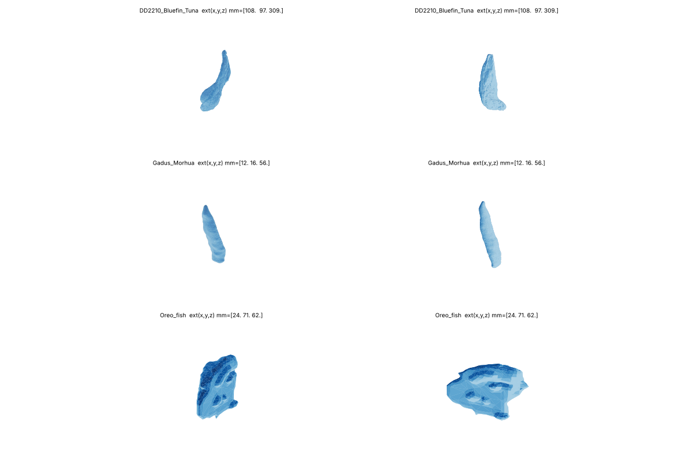

# 3D Swim Bladder Segmentation & Reconstruction

A research framework for **3D swim bladder segmentation from CT scans**,
geometric mesh reconstruction, and multi-model benchmarking. It compares
analytical methods, a trained 2D U-Net and a foundation model on the same
scans, the same box and the same reference masks, and turns the result into a
mesh you can look at and measure.

## Quick start

```bash
python3 -m venv .venv && source .venv/bin/activate   # Windows: .venv\Scripts\activate
python -m pip install -r requirements.txt
python -m src.api.app
```

Open `http://127.0.0.1:5000`. Runtime settings live in `src/api/config.toml`.

Raw scans are not in the repository (`data/raw/` is git-ignored); put them there
yourself, as [docs/data.md](docs/data.md) describes.

```bash
python -m pytest -q
```

## The application

| Page | What it is for |
|---|---|
| `/preprocess` | Load a scan from `data/raw`, resample it, set its intensity range, preview a slice |
| `/segment` | Draw a box around the bladder, click a seed point, run a method |
| `/experiments` | Every run in `results/`, as a table and a chart grouped by specimen |
| `/viewer` | The reconstructed mesh, rotatable, downloadable as `.glb`, `.stl`, `.obj` or `.ply` |

The routes, the preprocessing panel and the viewer are described in
[docs/web-app.md](docs/web-app.md).

## Semi-automatic segmentation

The methods work on the part of the scan the user points at, not on the whole
volume: on the axial image of `/segment` you drag a box around the bladder (on
the slice where it is largest) and click inside it to set the seed point. The box
covers all slices, the method receives only its contents, and the mask is put
back on the full grid, so mesh and metrics always work on the whole scan.

| Method | What it does |
|---|---|
| `box_region` | Thresholds between the brightness of the bladder and of the tissue, limited to the body |
| `chan_vese` | Improved Chan-Vese, 2D slice by slice |
| `geodesic_active_contour` | Geodesic active contour (MorphGAC), 3D |
| `growcut` | GrowCut cellular automaton, 3D |
| `unet_2d` | 2D U-Net (resnet34), pretrained on lung lobes and fine-tuned on the three fish |
| `sam_med3d` | SAM-Med3D foundation model, one click in a 3D box, no training |

Each of the three analytical methods can start either from a small ball around
the seed point (`init_from: seed_ball`, the default) or from the measured
contrast between the bladder and the tissue (`init_from: contrast`), which is
much more accurate on our scans and reports whether the contrast is high enough
to trust the result at all:

| Method | Oreo, seed ball | Oreo, contrast | Gadus, seed ball | Gadus, contrast |
|---|---|---|---|---|
| `box_region` | - | **0.949** | - | 0.628 |
| `chan_vese` | 0.085 | 0.939 | 0.233 | 0.494 |
| `geodesic_active_contour` | 0.180 | 0.772 | 0.210 | **0.727** |
| `growcut` | 0.585 | 0.851 | 0.597 | 0.586 |

Dice against the reference mask, same box and same seed point for every method.
See [docs/contrast.md](docs/contrast.md) for how the contrast is measured, what
it changes for each method, and how to reproduce the table:

```bash
python scripts/measure_contrast.py
python scripts/compare_methods.py
```

### Results

Every method also runs as an experiment, so a run of any of them lands in
`results/` with its mask, its mesh and its metrics, and shows up on the
Experiments page next to the others. On the Oreo fish, where all four analytical
configs use the same box and the same seed point, what the numbers measure is
the method and nothing else:

| Method | Dice | IoU | Volume | Run time |
|---|---|---|---|---|
| `box_region` | **0.935** | 0.878 | 31.8 mL | 0.01 s |
| `chan_vese` | 0.924 | 0.859 | 32.1 mL | 0.15 s |
| `growcut` | 0.819 | 0.693 | 21.6 mL | 0.02 s |
| `geodesic_active_contour` | 0.757 | 0.609 | 19.7 mL | 0.04 s |

(Oreo fish, reference volume 31.2 mL. These are the numbers the runner produces;
the table further up comes from `compare_methods.py`, which measures the methods
on its own box.)

The Bluefin tuna is the hard case and the analytical methods stay under 0.3 on
it. That is a property of the target rather than of the methods: what its
reference mask outlines is only 6% gas by volume and 24% denser than 300 HU, so
the largest connected gas region inside it reaches a Dice of 0.11 against the
mask. Only the trained U-Net recovers the outline. See
[docs/data.md](docs/data.md) for the measurement and for which of the tuna's two
annotations to measure against.

Each run also writes a `method_report.json` with the contrast the method
measured, the parameters it used and anything it warned about, such as a region
that reached the wall of the volume.

### SAM-Med3D

`sam_med3d` runs the SAM-Med3D foundation model (`sam_med3d_turbo.pth`, no
training) on one click in a 3D box. The box must also be limited in z: the
model's 128^3 cube is centred on the box and scaled so that its longest side
fills it. Its normalisation assumes HU, so on scans with almost nothing below 0
(mass density, Gadus) `intensity_shift: auto` moves 0 to where HU has it.

Torch, the pinned upstream source and the weights are installed separately, to
`sam-med3d-assets/` next to the repository or wherever `--assets` or
`SAM_MED3D_ASSETS` points (about 1 GB with torch):

```bash
python scripts/install_sam_med3d.py
python -m src.pipeline.runner configs/experiments/sam_med3d_oreo.yaml
python -m pytest -m slow    # the tests that need the real weights
```

Fine-tuning its decoder on our three fish did not help: trained on two fish and
tested on the third it does worse than the published weights in 5 of 6 cases.
See [docs/sam_med3d_finetuning.md](docs/sam_med3d_finetuning.md).

## Running one experiment

`src/pipeline/runner.py` runs a single experiment from a `.yaml` config
(`configs/experiments/`): load, preprocess, crop to the box, segment, then
`mask.nii.gz`, the mesh and `metrics.json` in the result directory.

```bash
python -m src.pipeline.runner configs/experiments/check_oreo_box.yaml
```

The algorithm runs `experiment.repetitions` times from the same seed, and the
runner reports the run times and whether the repetitions agreed. When the
spacing of the reference mask differs from the prediction, the reference is
resampled onto the grid of the prediction before the metrics are computed.

## Mesh reconstruction

`src/pipeline/mesh.py` turns a 3D binary mask into a triangle mesh
(Marching Cubes, Taubin smoothing, quadric decimation) and exports it as
`.glb`, `.stl`, `.obj` or `.ply`.

Meshes built from the three reference masks in `data/reference_masks/`
(Bluefin Tuna, Gadus Morhua, Oreo fish):



## Repository layout

- `configs/` - `default_config.yaml` and one `.yaml` per experiment in `experiments/`
- `data/raw/` - input CT scans, git-ignored; `data/reference_masks/` - ground truth from 3D Slicer
- `results/` - what the runner writes, git-ignored
- `src/core/` - `Volume`, the loaders (DICOM, TIFF, JSON, NIfTI) and the preprocessor
- `src/models/` - the segmentation methods; `foundation/` holds SAM-Med3D
- `src/pipeline/` - `runner.py`, `metrics.py`, `mesh.py`
- `src/api/` - the Flask application, its templates and its static files
- `scripts/` - installing SAM-Med3D, splitting a DICOM dump, measuring contrast
- `docs/` - [web-app](docs/web-app.md), [data](docs/data.md),
  [contrast](docs/contrast.md), [SAM-Med3D fine-tuning](docs/sam_med3d_finetuning.md)
