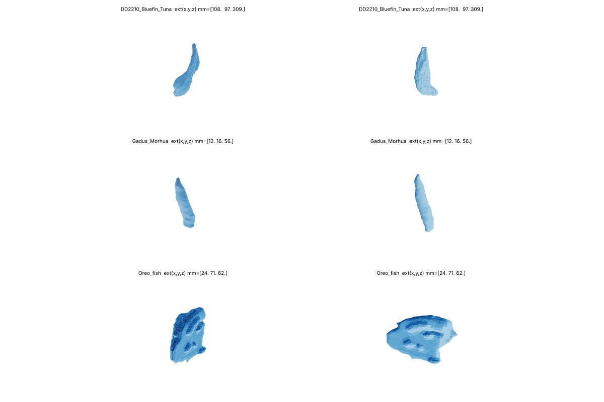

# 3D Swim Bladder Segmentation & Reconstruction

A research framework for **3D swim bladder segmentation from CT scans**, geometric mesh reconstruction, and multi-model benchmarking.

---

## Flask Application

Create and activate a virtual environment:

```bash
python3 -m venv .venv
source .venv/bin/activate
```

On Windows:

```powershell
python -m venv .venv
.venv\Scripts\activate
```

Install dependencies:

```bash
python -m pip install -r requirements.txt
```

The `src/api/config.toml` file contains application runtime settings. Adjust it
if needed, then start Flask:

```bash
python -m src.api.app
```

Open `http://127.0.0.1:5000` to verify that the standalone web application is
running.

### Application endpoints

The Flask application is organized around separate routes, so further pages
and endpoints can be added without changing the application entry point.

| Method | Endpoint | Purpose |
|---|---|---|
| `GET` | `/` | Application entry point |
| `GET` | `/health` | Health check |
| `GET` | `/preprocess` | Display the volume preprocessing form |
| `POST` | `/process` | Load and preprocess uploaded JSON, TIFF, or DICOM data |

After `POST /process`, the **Processed volume** page displays the unified
`Volume` metadata: source format, input/output shape, spacing, units, output
value range, source SHA-256 hash, and the middle axial slice after
preprocessing.

Future route groups can be added for `/segmentation`, `/mesh`, `/metrics`, and
`/export`.

### Running tests

With the virtual environment activated, run:

```bash
python -m pytest -q
```

## Semi-automatic segmentation

The methods work on the part of the scan the user points at, not on the whole
volume: on the axial image of `/segment` you drag a box around the bladder (on
the slice where it is largest) and click inside it to set the seed point. The box
covers all slices, the method receives only its contents, and the mask is put
back on the full grid, so mesh and metrics always work on the whole scan.

| Method | What it does |
|---|---|
| `box_region` | Thresholds between the brightness of the bladder and of the tissue, limited to the body |
| `chan_vese` | Improved Chan-Vese, 2D slice by slice |
| `geodesic_active_contour` | Geodesic active contour (MorphGAC), 3D |
| `growcut` | GrowCut cellular automaton, 3D |

Each of the three analytical methods can start either from a small ball around
the seed point (`init_from: seed_ball`, the default) or from the measured
contrast between the bladder and the tissue (`init_from: contrast`), which is
much more accurate on our scans and reports whether the contrast is high enough
to trust the result at all:

| Method | Oreo, seed ball | Oreo, contrast | Gadus, seed ball | Gadus, contrast |
|---|---|---|---|---|
| `box_region` | - | **0.949** | - | 0.628 |
| `chan_vese` | 0.085 | 0.939 | 0.233 | 0.494 |
| `geodesic_active_contour` | 0.180 | 0.772 | 0.210 | **0.727** |
| `growcut` | 0.585 | 0.851 | 0.597 | 0.586 |

Dice against the reference mask, same box and same seed point for every method.
On the Bluefin tuna every method returns an empty mask with `init_from: contrast`,
because what its reference mask outlines is as dense as the tissue around it;
[docs/contrast.md](docs/contrast.md) shows the numbers.
See [docs/contrast.md](docs/contrast.md) for how the contrast is measured, what
it changes for each method, and how to reproduce the table:

```bash
python scripts/measure_contrast.py
python scripts/compare_methods.py
```

### Preparing a DICOM dump

The Bluefin tuna scan arrives as a flat folder of files without an extension,
with seven series mixed together. `load_volume(path, "dicom")` reads `*.dcm` from
a folder and treats it as one volume, so the dump is split first:

```bash
python scripts/to_dicom_folders.py data/raw/DD2210_Blue_Tuna/DD2210 --dry-run
python scripts/to_dicom_folders.py data/raw/DD2210_Blue_Tuna/DD2210
```

The files already are DICOM; they only get a name the loader recognises, and one
folder per series. `--dry-run` prints what the dump holds:

| folder | description | slices | size | thickness | z step |
|---|---|---|---|---|---|
| `02_CUERPO_CUERPO_7_0` | CUERPO CUERPO 7.0 | 263 | 512x512 | 7 mm | 3.5 mm |
| `03_HUESO_HUESO_7_0` | HUESO HUESO 7.0 | 263 | 512x512 | 7 mm | 3.5 mm |
| `04_CUERPO_CUERPO_2_0` | CUERPO CUERPO 2.0 | 918 | 512x512 | 2 mm | 1 mm |
| `06_HUESO_HUESO_2_0` | HUESO HUESO 2.0 | 918 | 512x512 | 2 mm | 1 mm |

(plus two scout/report series and one reformat). `CUERPO` is the body kernel and
`HUESO` the bone kernel; the reference mask belongs to `02_CUERPO_CUERPO_7_0`,
and `04_CUERPO_CUERPO_2_0` is the same body at 1 mm, covering the same z range
from the same origin.

Note that these slices overlap: 7 mm thick, reconstructed every 3.5 mm. The
distance between slices is therefore taken from their positions
(`ImagePositionPatient`) rather than from their thickness, and the loader warns
when a series is not evenly spaced. A long series is also read slice by slice
into the output array, so the 918-slice one loads in about 1 GB.

### Running one experiment

`src/pipeline/runner.py` runs a single experiment from a `.yaml` config
(`configs/experiments/`): load, preprocess, crop to the box, segment, then
`mask.nii.gz`, the mesh and `metrics.json` in the result directory.

```bash
python -m src.pipeline.runner configs/experiments/check_oreo_box.yaml
```

The algorithm runs `experiment.repetitions` times from the same seed, and the
runner reports the run times and whether the repetitions agreed. When the
spacing of the reference mask differs from the prediction, the reference is
resampled onto the grid of the prediction before the metrics are computed.

## Mesh reconstruction

`src/pipeline/mesh.py` turns a 3D binary mask into a triangle mesh
(Marching Cubes, Taubin smoothing, quadric decimation) and exports it as
`.glb`, `.stl`, `.obj` or `.ply`.

Meshes built from the three reference masks in `data/reference_masks/`
(Bluefin Tuna, Gadus Morhua, Oreo fish):




## 📁 Project Structure

> **Note:** This is the planned target structure. Some components are not implemented yet.

```text
├── configs/
│   ├── default_config.yaml           # base configuration
│   └── experiments/                  # experiment-specific YAML configs e.g., exp_002_unet.yaml
├── data/
│   ├── raw/                          # input CT scans (.dcm, .tif/.tiff, .json)
│   └── reference_masks/              # ground truth masks from 3D Slicer (.nii.gz)
├── results/                          # generated experiment outputs
├── src/
│   ├── __init__.py
│   ├── api/
│   │   ├── app.py                    # Flask app factory and entry point
│   │   ├── config.py                 # TOML configuration loading
│   │   ├── config.toml               # application runtime settings
│   │   ├── routes/
│   │   │   └── web.py                # HTML routes
│   │   ├── services/                 # application services
│   │   ├── templates/
│   │   │   ├── base.html             # shared page layout
│   │   │   └── index.html            # application entry page
│   │   └── static/
│   │       ├── css/
│   │       │   └── app.css            # application styles
│   │       └── js/
│   │           ├── app.js             # shared frontend behavior
│   │           └── webgl-viewer.js    # WebGL viewer
│   ├── core/                         # data loading & preprocessing
│   │   ├── volume.py                 # unified Volume (dataclass) representation
│   │   ├── loaders.py                # DICOM, TIFF & JSON loaders
│   │   └── preprocessor.py           # normalization, resampling & denoising
│   ├── models/                       # Segmentation models 
│   │   ├── analytical.py             
│   │   ├── unet.py                   
│   │   └── foundation/               
│   └── pipeline/                     # reconstruction, metrics & experiments
│       ├── mesh.py                   # Marching Cubes + smoothing + decimation
│       ├── metrics.py                # Dice, IoU, HD95, ASSD & VS
│       └── runner.py                 # deterministic experiment runner
├── tests/                            # unit & integration tests
├── .gitignore
├── requirements.txt
├── LICENSE
└── README.md
```
---
