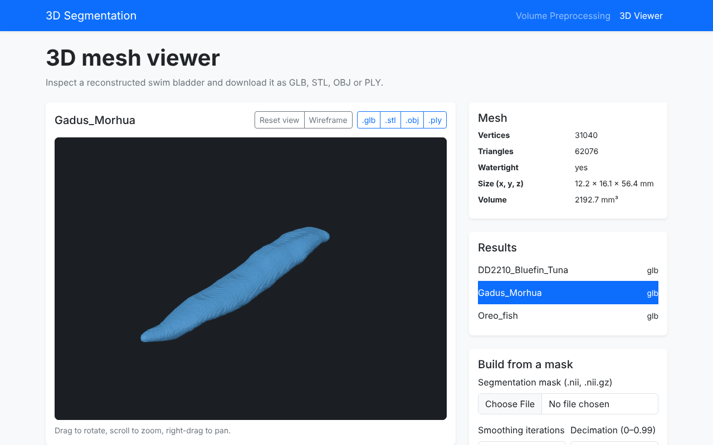

# The web application

How the Flask application is laid out, and what its two data panels do. The
README covers starting it; this covers using it.

## Routes

The application is organised around separate route groups, so pages can be
added without touching the entry point.

| Method | Endpoint | Purpose |
|---|---|---|
| `GET` | `/preprocess` | Display the volume preprocessing form |
| `GET` | `/datasets` | Redirect to the unified raw data preprocessing page |
| `POST` | `/datasets` | Save uploaded files as a new server-side dataset |
| `POST` | `/datasets/refresh` | Re-scan all server-side datasets in the background |
| `POST` | `/datasets/<id>/delete` | Delete a server-side dataset and all of its files |
| `POST` | `/datasets/<id>/rename` | Rename a server-side dataset |
| `POST` | `/datasets/<id>/sources/delete` | Delete one source item from a dataset |
| `GET` | `/api/datasets/status` | Report background dataset indexing status |
| `GET` | `/viewer` | 3D mesh viewer (`?id=<result>` opens `results/<result>/mesh.*`) |
| `GET` | `/meshes/<id>/mesh.<fmt>` | Mesh as `glb`, `stl`, `obj` or `ply` (`?download=1` saves the file) |
| `POST` | `/process` | Load and preprocess a selected server source or uploaded JSON, TIFF, or DICOM data |
| `POST` | `/viewer/build` | Build a mesh from an uploaded NIfTI mask and open it in the viewer |
| `POST` | `/process/start` | Start server-side preprocessing in the background |
| `GET` | `/process/<job_id>/status` | Get background preprocessing status |
| `GET` | `/process/<job_id>/result` | Open the preview for a completed preprocessing job |
| `GET` | `/datasets/<id>/sources/<source>/recommendations` | Calculate preprocessing suggestions for a validated source |

At startup the server-side datasets are indexed in a background thread. The
interface shows the loading status and reloads the list when indexing is done,
and the preprocessing form then offers only validated sources.

## Raw Data Preprocessing panel

This panel works on data placed directly on the server rather than uploaded
through the browser, so large raw volumes never travel over HTTP. Put the data
under `data/raw/<dataset_name>` and click **Refresh all data**; the directory is
re-scanned in the background and the panel reloads once the catalog is ready.
See [data.md](data.md) for the layout the scanner accepts.

Each dataset lists every direct file or folder as a source, and a validated one
can be processed with **Process data**. The settings modal holds:

- **Target spacing (Z, Y, X)** - physical voxel size in millimetres after
  resampling;
- **HU range (min, max)** - the intensity limits applied during preprocessing.
  On non-calibrated data these are an intensity range, not clinical HU;
- **Invert HU values** - reverses the intensity direction;
- **Enable denoising** - applies the configured noise-reduction step.

The suggestions the modal opens with are computed from the source itself, read
through the same loader that will preprocess it, so the shape and spacing shown
match the real volume. `Target spacing` is copied from `Volume.spacing_mm` in
`(Z, Y, X)` order. The intensity range considers only finite voxels, rounding
the minimum down and the maximum up, so the suggestion covers every observed
value instead of clipping at the boundaries. A source with spacing
`[3.0, 3.0, 3.0]` holding values from `1.0` to `1293.67` therefore gets:

```text
Target spacing: 3,3,3
HU range:       1,1294
```

Both fields stay editable, because these are starting points rather than
settings to keep. A smaller target spacing multiplies voxels through
interpolation without adding physical detail, and a narrower intensity range
raises contrast but discards everything outside it.

Previews of completed runs are kept under `results/preprocessed` and restored at
startup, so they survive a page refresh or a restart. The preview page fetches
only the slice being looked at instead of embedding the whole volume in the
response, and processing continues in a background thread while the user moves
around the application.

After `POST /process` the **Processed volume** page shows the unified `Volume`
metadata: source format, input and output shape, spacing, units, output value
range, the source SHA-256 hash, and the middle axial slice.

## 3D viewer

`/viewer` shows meshes stored as `results/<experiment_id>/mesh.<format>`, the
convention the experiment runner follows, in a WebGL viewer built on three.js.
Rotate with the mouse, zoom with the wheel, switch to wireframe, and download
the mesh as `.glb`, `.stl`, `.obj` or `.ply`; a format that was not written to
disk is converted on request.

A mesh can also be built in the browser: upload a segmentation mask (`.nii` or
`.nii.gz`), choose smoothing and decimation, and the result is stored as
`results/mask_<timestamp>_<id>/mesh.glb`. `results/` is not tracked by git, and
its location can be changed with `results_dir` in `src/api/config.toml`.


